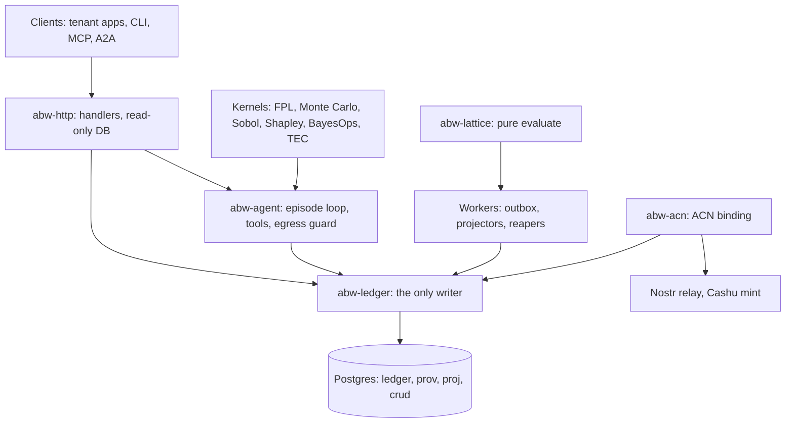

# ABW Core: Build Plan

Nov 10, 2026 · @ivan Labra · Status: **accepted** (ADR-0001)

ABW is rebuilt as a new, minimal core in `github.com/ilabra-axo/abw`. The core implements the design as written: an append-only event store with a single write boundary (CQRS), agents and episodes recorded end to end, the Verification Lattice, and ACN as the only path by which value enters or leaves. Proven parts of the legacy system (algorithm kernels, agent cards, prompts, strategists) are carried over deliberately. The legacy repository is frozen and kept as a reference until every tenant has moved.

This plan replaces the "ABW Refactor-in-Place Plan" and the "Coding Agent Directive: Lattice as Target" for all new work. Both stay in the legacy repo as history.

## 1. Why a new core

The legacy server is about 215k lines with 601 routes, 147 tables and 335 direct `UPDATE` sites (`docs/harvest/`). The rules the design depends on (one writer, history never rewritten, balances derived, records atomic with effects) cost almost nothing on new code and a migration per call site on old code. A year of in-place work showed that the dominant local pattern wins. So the core is built clean, and the rules are in CI from the first commit. There is nothing to ratchet down because nothing starts out of compliance.

## 2. What "done" means

ABW is at MVP when:

1. every requirement in `docs/requirements/register.toml` scheduled for MVP has a passing conformance test, shown by `cargo xtask trace`;
2. Fermi Console, SimOps and DPP Studio pass their own acceptance suites against the new core;
3. an independent audit (a fresh session with only the design documents and this repository) finds no P0 or P1 issue;
4. value moves only through ACN, demonstrated end to end on a test relay and test mint.

Nothing is done on an agent's or a demo's say-so.

## 3. Sources of truth

Higher rank wins. Code never wins over a design document; it is measured against it. Design changes happen only through an ADR in `docs/decisions/`, approved by Ivan.

| Rank | Document (path in this repo) | Governs |
| --- | --- | --- |
| 1 | `docs/design/verification-lattice-spec-v0.1.md` | Claims, dimensions, verdicts, judge, routing |
| 2 | `docs/design/economy.md` (new, §6 of this plan) | Money: allowance and ACN. Replaces the target design's §9 |
| 3 | `docs/design/capabilities.md` (Logical Architecture in Capability Terms) | What ABW must be able to do |
| 4 | `docs/design/target-system-design.pdf` + `docs/design/core-delta.md` | Mechanisms: ledger, append, projections, provenance, gates, security, conformance tests |
| 5 | `docs/design/logical-architecture-paper.md`, `feedback-loops.md`, `combinatorial-credit-assignment.md`, `creating-apps.md` | Primitives, loops, Shapley, apps |
| 6 | ACN spec (`ilabra-axo/acn`, `docs/acn/`) | Commitments, Cashu settlement |
| 7 | Legacy repo `Replicant-Partners/fermi` at commit `a3cea516` | Behavioural reference and source of kernels and data only |

`core-delta.md` records how the target design applies to a new codebase:

- **Adopted:** §1.2 invariants T1–T8 and T10–T20, §2.3–2.4 pools, schemas and roles, §3 ledger, §4 agent and episode, §5 Lattice, §6 provenance, §7 grounding, §8 gates as events, §10 vertical slices, §11 loops and policy, §12 extension surfaces, §13 security, §15 conformance catalogue, and the §16 recommendations as defaults.
- **Replaced:** T9 and §9 (wallets, issuer wallet, Stripe, royalties, sponsorship, debt, reconciliation) are replaced by `economy.md`.
- **Not applicable:** §14 migration, the ratchets in §14.6, and every `[K]` citation. These become "port from legacy at `path:line`" where a component is carried over.

## 4. Fears, and the mechanism that answers each

| Fear | Mechanism |
| --- | --- |
| The intended design won't be built | **Requirement register and traceability.** Every Lattice rule, every row in `capabilities.md`, T1–T20 and ECO-1–9 gets an ID in `register.toml`, with a milestone and a test. `cargo xtask trace` fails CI if a requirement scheduled for a closed or current milestone has no passing test. Tests are written before the code they test. The matrix is generated, never written in prose. |
| Important things get dropped (cohere\_and\_coordinate, strategists, Shapley, loops) | **Feature harvest (M0).** Every legacy route, table, agent card, crate and loop is listed in `docs/harvest/` with a disposition: requirement ID, tenant, port-as-data, kernel, or *dropped, approved by Ivan*. Nothing is dropped by omission. The protected list in §9 is named in the register from day one. |
| An audit finds economic leaks or a D+ | **Construction, not vigilance.** Only `abw-ledger` holds a write-capable connection, so a handler that writes does not compile. Balances are projections the database refuses to change without an event. No event type can move value between owners. Value enters only from a verified ACN settlement. Each milestone ends with an independent audit; every finding becomes a test or an ADR. |
| The Lattice needs rework | **Isolation.** The Lattice is a pure crate (`abw-lattice`) behind `evaluate_v1`. The core depends only on its events. Rework ships as `evaluate_v2` with a new policy version; old verdicts still replay (OD-29). |

## 5. Architecture



**Two kinds of state**, per `capabilities.md`. Trust state (claims, verdicts, decisions, gate decisions, allowance, agent versions, episodes, provenance, policy, publications) is event-sourced. Workspace state (UI, files, memory, creatures, drafts) is ordinary CRUD, written only through `abw_ledger::crud`, and cited by trust state only through hashed artifacts.

**Workspace layout.** Crates are added only when a milestone needs them.

```text
abw/
  crates/
    abw-canon      JCS (RFC 8785) and sha256: hashes; pure
    abw-ledger     event store, append, command dispatch, projections, outbox,
                   artifacts, migrations, crud; the only crate with a write pool
    abw-domain     aggregates and commands (pure decide functions)
    abw-agent      episode pipeline, LLM providers, tools, egress guard
    abw-lattice    evidence and verdict (separate modules), routing; pure
    abw-acn        ACN binding; the only crate depending on Nostr or Cashu
    abw-http       axum handlers; no sqlx dependency
    abw-server     binary: config, roles (api, worker), wiring
    kernels/       ported, oracle-certified pure crates
  migrations/      SQL, run once, checksummed
  tests/conformance/  one test per register ID
  xtask/           trace, check, milestone
  docs/            design, decisions, requirements, harvest, plan
```

**Stack.** Rust stable, edition 2024, tokio, axum, sqlx (Postgres 16), serde, sha2, thiserror, tracing. JCS is in-tree (OD-03). A new dependency needs an ADR. `cargo deny` bans `sqlx` outside `abw-ledger`, and Nostr and Cashu crates outside `abw-acn`.

## 6. Economy: allowance plus ACN

There are no wallets, no internal currency, no transfers and no Stripe. The intent in the legacy design (internal credits with transfers) is withdrawn.

| Flow | Mechanism |
| --- | --- |
| Buy usage | An ACN purchase commitment to the operator, settled in Cashu. On settlement, `abw-acn` appends `allowance.funded` to the buyer's `allowance:<owner>` stream |
| Spend inside your own estate | Each episode places a hold on its owner's allowance before work (TX-A). The executor cannot spend past the hold. The close transaction (TX-C) records actual use and releases the rest |
| Workspace and app budgets | A spend cap on the owner's allowance, checked when the hold is placed. Not a balance; no value moves when an app is spawned |
| Sell, rent or license to another owner | An ACN commitment with conditions of satisfaction. The Lattice verdict is delivery evidence; the requester declares satisfaction; sats settle to the owner's key |
| Use another owner's agent | An ACN rental. Renter-hosted: runs on the renter's allowance. Owner-hosted: a service call priced over ACN |

**Invariants (ECO).**

- **ECO-1.** An allowance changes only through events on its own stream. `available = funded + granted − consumed − held` is a projection the database will not change without an event (T3).
- **ECO-2.** `allowance.funded` requires a settled ACN commitment reference verified by `abw-acn`, and is idempotent on that reference.
- **ECO-3.** `allowance.granted` (operator onboarding grant) requires the operator actor and is capped per owner by policy.
- **ECO-4.** No event type moves allowance between owners. A consumption event must cite an episode owned by the stream's owner.
- **ECO-5.** A hold is placed before work and is a hard ceiling. Settlement and release commit in the episode-close transaction. Actual use is never above the hold, so there is no debt.
- **ECO-6.** Every allowance event carries an idempotency key. A retry never funds or charges twice.
- **ECO-7.** `available ≥ 0` and `held ≥ 0` are enforced by the database.
- **ECO-8.** Value between owners moves only through ACN commitments. Only allowlisted event types leave through the outbox.
- **ECO-9.** Only `abw-acn` depends on Nostr, Cashu or key-store crates. No private key material appears in DB columns, logs or error strings.

This deletes the classes of finding the audits raised: there is nothing to mint without a settlement, nothing to transfer, and no charge outside an episode transaction.

## 7. Milestones

Milestones run in order. Each closes only when `cargo xtask milestone <n>` passes in CI and the independent audit is resolved. Kernel porting runs alongside M1–M3 because it touches no shared state.

### M0: Foundations (no product code)

- Repository skeleton, CI (fmt, clippy `-D warnings`, `cargo deny`, tests against a Postgres service), branch protection, CODEOWNERS, `AGENTS.md`.
- Import the design documents into `docs/design/`. Write `core-delta.md` and `economy.md`. ADR-0001 records this plan; ADR-0002 adopts the target design's §16 defaults; ADR-0003 adopts allowance plus ACN.
- Build `register.toml` and `cargo xtask trace`.
- Feature harvest of legacy into `docs/harvest/`. You review every *drop*.
- Legacy is left as it is: no commits or tags. The harvest pins commit `a3cea516`; uncommitted legacy work isn't carried over.
- **Exit:** trace runs in CI; every harvested item has a disposition; the drops are approved in an ADR.

### M1: Event store

`abw-canon` and `abw-ledger` per target design §3: schemas and roles, immutability triggers, streams with expected-version append, command dispatch with idempotency, inline projections guarded by the database, async projectors with the visibility fence, transactional outbox, content-addressed artifacts, checksummed migrations, `read_query!`, `crud`.

- **Exit:** T1–T6 conformance tests pass: a handler write fails to compile; 32 concurrent appends produce one winner; projections cannot change without an event; JCS vectors; fault injection at every statement; the database refuses UPDATE, DELETE and TRUNCATE. Rebuild from events is byte-identical to live projections.

### M2: Agents, episodes, allowance

Agent versions as JCS hashes of resolved cards. Per-card tool allowlists. Episodes as streams with TX-A/B/C and durable tool invocations. LLM provider interface. Egress guard. Tenancy on every read by ID. Allowance aggregate (ECO-1–7, operator grants only; ACN funding arrives in M4). Episode and hold reapers. Legacy cards imported as data.

- **Exit:** T5 one-run-one-transaction, T17 IDOR matrix, T18 SSRF guard, and ECO-1–7 pass; a real agent runs an episode end to end and every tool call is provable by hash.

### M3: Lattice and Fermi (first tenant)

Claims, provenance graph, evidence collection, `evaluate_v1`, independent judge, routing, versioned policy, human decisions, outcome observer (Polymarket). Kernels ported with independent oracles: FPL, Monte Carlo, Sobol, Brier, Shapley, BayesOps. The minimum composition Fermi needs: team members plus `moe_router_strategist`. Fermi Console pointed at the new API.

- **Exit:** T8 and T10–T16, T19 and T20 pass; Lattice adversarial cases (planted fabrication, stale citation, provider outage, judge injection, valid derivation chain); the Fermi acceptance suite passes; independent audit.

### M4: ACN

`abw-acn` on the outbox: keypairs per agent and operator, encrypted key store, buying allowance, selling and renting.

- **Exit:** ECO-2, ECO-8 and ECO-9 pass; one purchase and one rental round-trip on a test relay and test mint.

### M5: Coordination and loops

Compositions and workspaces in full. Strategists: cohere\_and\_coordinate (TEC Γ, cascade to members' memory, coordination brief, valence-homophily guard), pipeline, debate and vote. Memory and consolidation. Loops in order of verifiability: 5 (calibration), 2 (human correction), 1 (consolidation of verdict-qualified episodes only), 4 (composition evolution, proposals only), 3 (workspace coherence).

- **Exit per loop and strategist:** an acceptance test from `feedback-loops.md` showing its gate fires, admits valid input, and rejects input that satisfies a proxy but not the property.

### M6: Tenants and decommission

SimOps, then DPP Studio (strictest suite), then Rabble, then the rest. For each: a one-page claim spec, its acceptance suite merged before the port, then the port. Legacy is archived when the last tenant moves.

## 8. How work is done

- **Pull requests only.** `main` is protected. CI must pass. You are the approver.
- **Tests before code.** A conformance or acceptance test is merged, failing, before the code that makes it pass. The PR that adds a test cannot change product code (CI check).
- **Builder and Verifier are separate agent sessions** with no shared context. The Verifier writes tests from the design documents, never from the implementation.
- **Every PR names the register IDs it serves** and includes `cargo xtask trace` before and after.
- **No pattern, crate or abstraction the design does not name.** If one seems needed, an ADR comes first.
- **Never weaken a check to pass.** A disputed check gets an issue titled `CHECK-DISPUTE: <id>`, and work on it stops.
- **Comments and docs that describe behaviour cite `path:line`.**

## 9. Protected capabilities

Each of these gets a register ID in M0 and a milestone. None is dropped without an ADR.

| Capability | Legacy source | Milestone |
| --- | --- | --- |
| cohere\_and\_coordinate (TEC Γ, conflict classification, cascade, brief, homophily guard) | `agents/curated/cohere_and_coordinate`, `agent-bestiary/coherence*` | M5 |
| Pipeline, MoE routing, debate and vote strategists | `agents/curated/*_strategist` | M3 (MoE), M5 |
| Exact Shapley credit with residual and reconstruction gates | `src/attribution/` | M3 |
| FPL, Monte Carlo, Sobol | `src/lexer.rs`, `parser.rs`, `executor.rs`, `sensitivity.rs`, `crates/projections` | M3 |
| BayesOps | `crates/posterior`, `crates/posterior-reg` | M3 |
| Calibration and Brier | `src/calibration.rs` | M3 |
| Five feedback loops | `docs/architecture/FEEDBACK_LOOPS.md` | M5 |
| Memory and consolidation | `agent-bestiary/memory`, `agent-bestiary/consolidate` | M5 |
| Evaluators (Sotopia, WildGuard, faithfulness) | `agent-bestiary/evaluator*` | M5 |
| 104 curated agent cards and prompts | `agents/curated/` | M2 (as data) |
| Dynamics and SimOps models | `crates/dynamics`, `crates/simops` | M6 |
| DPP and carbon accounting | `src/handlers/workspace/carbon.rs`, `apps/adaptogen-lab/dpp` | M6 |

The full list comes from the harvest. This table is its floor, not its ceiling.

## 10. Decisions needed

**Decided:** the repository is public. Legacy is left untouched; its uncommitted work isn't carried over.

**Open, not blocking:**

1. **Licence.** The Unlicense or MIT. Until one is added, the code is all rights reserved.
2. **Harvest drops.** Approve or reject each `drop?` in `docs/harvest/` (ADR before M0 closes).
3. **Missing tenants.** Where Pulse, Arborea, the architect lens and the cow-tipping game live.

**Before M2:**

4. **Allowance unit.** Sats (msat) priced by a versioned price policy (recommended: no conversion layer), or abstract compute units.
5. **Onboarding grants.** Should operator grants exist at all, and with what cap per owner?
6. **Hosting.** A new Railway service and a new Neon database, with legacy left running until tenants move (recommended).

**Later:** Cashu mint and custody (M4); judge model lineage (M3); Lattice scope per tenant (M3, M6); who adjudicates Loop 2 corrections (M5); counsel on the regulatory treatment of prepaid allowance before any sale (M4).
