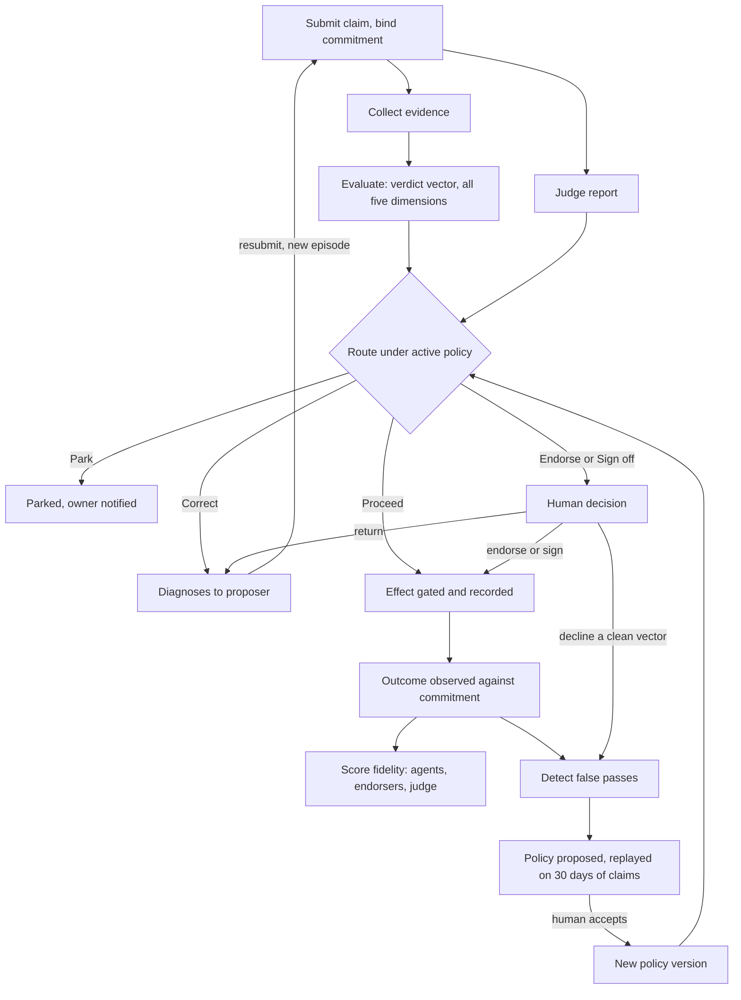

# ABW — Logical Architecture in Capability Terms

Nov 6, 2026 · @ivan Labra

**Status:** Target. Requirements, not a description of current behaviour. The trust half is unbuilt; the agency half is partly built (see `docs/architecture/FEEDBACK_LOOPS.md` for what is verified).

## Purpose

ABW is a substrate on which teams of agents do work under contracts, coordinate, and improve themselves through feedback loops — and on which every result is checked on evidence before anyone relies on it. It has three layers: **agency** (agents run, contract, coordinate, are observed, and learn), **trust** (claims are verified, decisions and money are recorded, outcomes are scored), and **apps** (agency packaged as products people enter and use).

This document says what ABW must be able to do, as noun–verb capabilities. The trust half follows the target system design (`ABW_TARGET_SYSTEM_DESIGN.pdf`, 180 pages, Rust/Postgres), which implements the Verification Lattice spec and SPEC 36. The agency half follows the feedback-loop and primitives work; it has no target design yet. The apps layer follows Doc 3, Creating Apps on ABW. The seams between agency and trust are listed as open questions.

ABW holds two kinds of state. **Trust state** — claims, verdicts, human decisions, gate decisions, money, agent versions, runs, provenance, policy versions, published artifacts — is append-only history. **Workspace state** — UI, creatures, working drafts, files, memory — is ordinary editable data. Trust state may point to workspace state's content only through frozen, hashed copies.

## The nouns

Twenty-seven things carry the whole system. Everything else is detail on one of them.

| Noun | What it is |
| --- | --- |
| **Agency** |  |
| Agent | A named identity with an owner, a tier, a persona and a status; one of the types below |
| Agent version | A frozen, hashed configuration of an agent (its "card"); every run cites exactly one |
| Episode | One run of an agent version: a bounded tool-calling LLM loop, recorded end to end |
| Tool call | One action an agent takes during an episode, stored with its result |
| Memory | An agent's episodic store and its knowledge graph of semantic rules |
| Composition | A team recipe: members, a strategist, a mission and an improvement mode |
| Workspace | A running instance of a composition: message thread, git-backed files, credit budget, event stream |
| Contract | The typed terms of a commissioned task: inputs, outputs, evidence and how it is checked |
| Coherence (Γ(C)) | A continuous score of how well a team's explanations fit together |
| Coordination brief | The per-session summary of coherence, written for the humans reading along; agents learn from coordination observations written into their memory, not from the brief |
| Evaluator signal | One measurement of an episode, either LLM-judged or hard-verified |
| Calibration | How well agents and teams predict externally grounded outcomes; a team's result is apportioned to agents by exact Shapley credit over counterfactual re-runs of the team forecast |
| **Trust** |  |
| Artifact | Content-addressed bytes (inputs, outputs, documents); never changes once stored |
| Claim | An agent's statement about its own work, pointing at artifacts and tool calls |
| Commitment | A claim's promise about the future: a probability, a condition and a deadline |
| Evidence | What the platform itself found when checking a claim against artifacts and sources |
| Verdict vector | Five independent results for a claim: Presence, Liveness, Truth, Grounding, Binding; each is pass, fail, unsupported or not evaluated, and every non-pass carries a diagnosis |
| Judge report | An LLM's opinion on a claim; advisory input, never evidence |
| Route | The action chosen for a claim: Proceed, Sign off, Correct, Endorse or Park. Not query routing, which picks experts (area 4) |
| Human decision | An endorser's or sign-off reviewer's endorse, sign, return or decline on a claim; it has the same standing as a lattice result and is scored against outcomes |
| Gate decision | A control's Approve, Refuse or Undetermined on a specific effect |
| Fidelity score | How reliably an agent's validated claims fulfil the contracts it was given; complementary to calibration, never a substitute |
| Provenance graph | Who and what produced each artifact, from which inputs |
| Wallet | A credit balance, kept as a double-entry ledger |
| Policy | Versioned thresholds and routing rules (θ) that every verdict and route cites |
| Outcome | What actually happened, observed later, against which commitments are scored |
| **Apps** |  |
| App | A registered manifest tying a canonical document schema, a fleet, a workspace template, a UI and (later) a pricing policy |

The actors are agents, humans (owners, endorsers, sign-off reviewers, task issuers), tenants and external systems (LLM providers, MCP servers, A2A callers, payment and market feeds).

## Agent types

A strategist is itself an agent, not a separate mechanism; a composition's coordination strategy is whichever strategist it seats. **"Pipeline" means two different things — keep them apart.** A *compound agent* hard-wires its own delegation to specialists. A *pipeline strategist* is a strategist that chooses staged, ordered coordination for a composition. Composition is still not the same as pipeline: a pipeline is one strategy a composition can adopt, not what a composition is.

| Type | Role | Examples |
| --- | --- | --- |
| Expert | A domain specialist working under a typed contract; a composition may narrow its capabilities further | adaptogen\_curator, football\_analyst, macro\_data\_agent |
| Compound agent | A front door that hard-wires delegation to its own specialists | social\_media\_studio (brief → image → caption → publish) |
| Coherence strategist | Keeps a workspace coherent: classifies conflict as destructive or productive and writes the coordination brief | cohere\_and\_coordinate |
| Pipeline strategist | Runs a composition as ordered stages, threading each stage's output into the next; validates the seams before executing, reports unfilled stages as typed open slots, and stops on failure rather than fabricating a stage | pipeline\_strategist |
| MoE routing strategist | Routes each query to the members with the best calibration record | moe\_router\_strategist |
| Debate strategist | Structures disagreement toward convergence | debate\_strategist |
| Platform agent | Serves the platform rather than one app | xaman\_ek (navigator), ontologist, observability\_coordinator, companion\_builder\_coach |

A composition's improvement mode is either **cascade** (Loop 3.A: within a session, the strategist's coordination findings cascade into members' memory) or **tune\_team** (membership changes across sessions; Loops 3.B and 4.A).

## Capabilities

ABW's requirements decompose into fifteen capability areas: six for agency, eight for trust, one for apps.

**Agency — doing the work and getting better at it**

### 1. Run agents

| Capability | Requirement |
| --- | --- |
| Version an agent | Each configuration change produces a new frozen, hashed version; retiring is soft |
| Run an episode | Execute one version on one task within a fixed iteration budget |
| Invoke a tool | Call only tools on that version's allowlist; record each call and result |
| Remember | Keep per-agent episodic and semantic memory, tagged with how well-sourced it is |

### 2. Compose teams

| Capability | Requirement |
| --- | --- |
| Hire an agent | Place an agent into a workspace under one hire rule; auto-hire uses the same authorisation |
| Change composition | Propose adding, removing or swapping agents when coordination keeps failing; the owner accepts or rejects |
| Guard diversity | Detect a team converging on one outlook (valence homophily) and counter it |

### 3. Contract work

One contract schema serves every agent. It is defined at the loop level and imposed uniformly; an agent whose checks do not fit it has a check doing two jobs.

| Capability | Requirement |
| --- | --- |
| Commission a task | A strategist issues a typed commission to an expert, naming the task and its conditions of satisfaction |
| Declare an expert contract | Each expert states what it accepts, what it produces and what it can be checked on |
| Record the episode contract | Every episode records input and output artifact hashes, independent evidence, the check's result, any failure detail, and the episode it corrects |
| Check against the contract | A gate oracle, separate from the strategist, verifies the result |
| Dispose of a result | The strategist accepts, retries or escalates on the verification result |
| Close a commitment | Requests move through open, bind, perform and close; the requester, not the performer, declares satisfaction |
| Chain corrections | Link each correction to the episode it fixes, so improvement can be checked rather than assumed |

### 4. Coordinate work

| Capability | Requirement |
| --- | --- |
| Route a query | The strategist picks experts by calibration first, then checks the team's diversity |
| Widen a query | When diversity collapses, decompose across a broader expert or add a contrasting critic seat; otherwise flag it unresolved |
| Measure coherence | Score how well the team's explanations fit together, each session |
| Classify conflict | Resolve destructive conflict; protect productive incoherence and surface it |
| Steer the session | Post a coherence update that steers the current conversation |
| Cascade to members | Write each member's coordination observation into that member's memory; only the workspace's registered strategist may write, and only to current members |
| Brief the humans | Write a coordination brief summarising the session for its readers |

### 5. Observe

| Capability | Requirement |
| --- | --- |
| Evaluate an episode | Run pluggable evaluators (Sotopia, WildGuard today) and record their signals |
| Grade a signal | Mark each signal LLM-judged or hard-verified; only hard-verified signals skip the coherence gate |
| Run the evaluators | An observability agent coordinates evaluators and has its own learning cycle |

### 6. Learn and improve

Five feedback loops improve the system; Loops 3, 4 and 5 each have two halves. Loops 1 to 5.A change the harness (context, configuration, routing), never model weights. Loop 5.B is the one exception: it refits distribution parameters, which is still not a weight update. Every loop that changes behaviour passes a human, the coherence gate or a deterministic check. Calibration means performance against external ground truth, such as forecasts against resolved Polymarket markets. It complements fidelity (area 13) and never substitutes for it.

| Loop | Changes | Driven by | Gated by |
| --- | --- | --- | --- |
| 1. Agent learning | An agent's semantic rules and knowledge-graph context | Evaluator signals, consolidated across episodes | Coherence gate for LLM-judged signals; hard-verified signals pass directly |
| 2. Human correction | An agent's persona version | A reviewer's intervention on an anomaly | Reviewer, then coherence gate |
| 3. Workspace coherence (3.A inner, 3.B outer) | The current conversation and members' memory (3.A, per session); a composition proposal (3.B, across sessions) | Coherence score; tension audit | Owner, for composition |
| 4.A Composition evolution | Team structure | Shapley credit and pairwise interactions; chronic coordination failures; homophily | Owner |
| 4.B Routing | Which experts the strategist picks | Loop 5.A calibration; route provenance joined to outcomes | Hard-verified signals |
| 5.A Calibration measurement | Nothing directly; consumed by Loops 1, 4.B and 5.B | Brier score against resolved markets, per team and per agent (Shapley); projection accuracy | Hard-verified signals |
| 5.B Parameter correction (BayesOps) | Forecast distribution parameters | Resolved outcomes and observation history | Monte Carlo impact gate: auto-accept, or held for human review |

The FPL Monte Carlo executor, which turns fitted or elicited parameters into forecast distributions and Sobol sensitivities, is not a feedback loop. The labels "Loop A" and "Loop B" are retired because they collided with this numbering.

**Trust — deciding what can be relied on**

### 7. Make claims

| Capability | Requirement |
| --- | --- |
| Submit a claim | State what the work produced, citing artifacts, tool calls and the state it read |
| Bind a commitment | Register a probability that a stated outcome will occur by a deadline |
| Resubmit a claim | Retry with corrections, within a limited budget, under a new episode |

### 8. Verify claims

| Capability | Requirement |
| --- | --- |
| Collect evidence | Match each claimed field against the actual artifacts and sources |
| Evaluate a claim | Score all five dimensions every time, with no short-circuit and no shared state with evidence collection |
| Judge a claim | Get an independent LLM's report from a different model family and prompt lineage; it can flag, never raise a score |
| Route a claim | Pick one action from the vector and judge report under the active policy |
| Diagnose a failure | Every non-pass names its cause, expected vs. observed, a suggested fix and remaining budget |
| Replay a verdict | Recompute any past verdict bit for bit from its recorded inputs |

### 9. Trace provenance

| Capability | Requirement |
| --- | --- |
| Record lineage | Link each artifact to the episode, tool call, source or derivation that made it |
| Walk a chain | Answer "does this trace to something outside the agent's say-so?" |
| Exclude opinion | Keep judge and evaluator narratives out of any provenance walk |
| Inherit a floor | Derived values are only as grounded as their weakest input |

### 10. Involve humans

| Capability | Requirement |
| --- | --- |
| Endorse a claim | A human vouches for a claim; the endorsement is itself scored later |
| Sign off a claim | A human approves a high-stakes claim before it takes effect |
| Return or decline | A human sends a claim back with a note, or declines it; declining a clean vector is recorded as a possible false pass |
| Park a claim | Hold an unresolvable claim with its diagnosis and notify the owner; never drop it |
| Cap human load | Refuse to route more open packets to a person or tenant than policy allows |

### 11. Gate effects

| Capability | Requirement |
| --- | --- |
| Approve or refuse an effect | A control blocks the effect it guards, recorded in the same transaction |
| Mark undetermined | When a check cannot run, treat it as not approved, with a reason |
| Record an observation | A check that only watches is labelled as such and never blocks or approves |

### 12. Account for money

| Capability | Requirement |
| --- | --- |
| Hold credit | Reserve funds before work starts |
| Settle a run | Charge actual cost and release the rest when the episode closes |
| Grant, deposit, transfer | Move credit with balanced double entries; retries never double-charge |
| Fund a spawn | Pay for, or sponsor, a new app workspace |

### 13. Score fidelity

**Fidelity is not calibration.** Fidelity measures how reliably an agent's validated claims fulfil the request it was given. Calibration (area 6) measures how well agents and teams predict externally grounded outcomes. The two are complementary and scored separately: a Fermi forecast earns a fidelity score when its claim is validated, and a calibration score when its market resolves.

| Capability | Requirement |
| --- | --- |
| Observe an outcome | Record what happened against each bound commitment |
| Score fidelity | Update how reliably each agent, endorser and judge fulfils contracts (Beta posterior over validated claims) |
| Detect false passes | Flag dimensions that passed a claim that later proved wrong, or that a human declined |
| Detect false fails | Flag dimensions that failed a claim a human then endorsed |
| Propose a policy change | Suggest new thresholds or routes, tested against 30 days of past claims |
| Accept a policy change | Only a human can make a proposal active |

### 14. Connect and protect

| Capability | Requirement |
| --- | --- |
| Serve tools | Expose published tools over MCP, each call metered and recorded as an episode |
| Accept tasks | Take A2A tasks, report state, deliver signed webhooks reliably |
| Publish an artifact | Release a verified result (e.g. a DPP) with its full trace |
| Isolate tenants | Reading any object by ID returns "not found" unless the caller may see it |
| Guard outbound calls | Never let a tenant-supplied URL reach a private address |
| Keep secrets | Encrypt credentials and signing keys at rest |

**Apps — packaging agency as products**

### 15. Build and ship apps

Make an app when there is a surface people enter, state worth keeping across sessions, a coherent team, and a canonical document the work revolves around. One agent answering questions is just a published agent; a team with no persistent state is just a composition.

| Capability | Requirement |
| --- | --- |
| Register an app | Submit a manifest tying a canonical document schema, a fleet, a workspace template and a UI; store manifest and template as artifacts so later edits never change existing workspaces |
| Define the canonical document | Publish a JSON Schema so UIs can validate it and agents know what shape to produce |
| Assemble a fleet | Reuse bestiary agents, fork variants or author new ones; register the fleet as a reusable composition |
| Spawn a workspace | Provision a runtime from the template: budget, auto-hired agents, initial files |
| Read and write state | The UI reads and writes the canonical document in the workspace |
| Invoke agents | Message an agent in the workspace (charges its budget) or execute one directly (charges the user's wallet) |
| Set visibility | Private, unlisted (anyone with the slug) or public (listed) |
| Share a workspace | Let colleagues work in the same workspace |
| Be discovered | Xaman Ek describes the app from its manifest's description and tagline |
| Price an app | Metered or subscription pricing with a revenue share; reserved, inert until revenue accounting ships |

Six patterns are ready to copy: stateful interview (SimOps), side-by-side variants (SimOps Scenarios), regulatory lens renderer (Adaptogen Lab), content pipeline (social\_media\_studio), AR/spatial (Rabble) and forecasting (Fermi Console). A seventh, transactional kiosk (Tonic Lab), is documented but not yet built.

## How a claim is decided

The trust half runs one path per claim, with three loops of its own: the inner loop corrects a single claim, the middle loop scores who was right, and the outer loop tunes policy with a human's approval.

Correct and resubmit is the inner loop. Outcome to fidelity is the middle loop. False passes to a new policy version is the outer loop.

The judge's report and the verdict vector reach Route separately, so an LLM's opinion can flag a claim but never lift its score.

## What must always hold

Agency rests on three rules:

- **Loops change the harness, not the model.** Context, configuration, routing and (Loop 5.B) distribution parameters are revised; weights are not.
- **No loop changes behaviour unchecked.** A human, the coherence gate or a deterministic check (a resolved outcome, 5.B's impact gate) stands on every path that alters an agent or a team.
- **Thresholds are provisional priors.** Every threshold and weight is open to revision by a loop.

Trust rests on ten, distilled from the target design's twenty invariants (T1–T20):

1. **One writer.** Only one component can change trust state; everything else can only read it. (T1)
2. **History is never rewritten.** Trust state is appended, not edited; current state is derived from history. (T2, T3, T6)
3. **Record and effect commit together.** No decision, charge or verdict is written "later". (T5)
4. **Evidence is not verdict.** The code that gathers evidence cannot also decide the outcome. (T8)
5. **Opinion is not provenance.** An LLM's judgement can inform routing but never counts as a source. (T10, T15)
6. **All five dimensions, every time.** Verification is a lattice, not a ladder, with a closed verdict vocabulary. (T12, T13)
7. **Every failure is a diagnosis.** Nothing is silently dropped; the worst case is Parked with an owner told. (T14)
8. **Controls block or they are not controls.** "Couldn't check" is never "approved". (T7)
9. **Verdicts replay exactly.** Same inputs and policy version, same result. (T11)
10. **Machines propose, humans accept.** No threshold or routing rule changes without a human. (T20)

Tenant isolation (T17), balanced money (T9) and the outbound guard (T18) are also absolute (area 14). Binding scored from a claim's own probability (T19) is the subject of the first open seam below. One hash format (T4) and reserved dimension names (T16) are implementation discipline, left to the target design.

## Open: where the halves meet

The target design specifies trust and treats most of the agency half as ordinary editable data. That leaves five seams unresolved:

- **The target conflates fidelity and calibration, and drops Shapley credit.** It computes Brier inside the lattice's middle loop (T19), where only fidelity belongs. Per-agent calibration already exists as exact Shapley credit over counterfactual re-runs of the team forecast (`src/attribution/`, `forecast_agent_credit`). `compute_agent_calibration` reports it alongside team Brier, and the routing views use it as their headline metric. The target never mentions Shapley. It cites `outcome_trust.rs:24-36`, which documents `record_forecast_calibration_signals` copying the forecast's Brier to every contributing agent. It replaces that copy with per-claim Brier from each claim's own probability and points `select_agent` at the result. The two measure different things: how good an agent's own probability was, versus how far it moved the team's forecast. Fermi specialists claim driver multipliers rather than a probability on the question, so per-claim Brier may have nothing to score them on. The Shapley split and its validity gates (efficiency residual, reconstruction error) must be carried over explicitly or they will be lost.
- **Memory and fitted parameters change behaviour but are not trust state.** Loop 1 alters agents through semantic rules, and Loop 5.B rewrites forecast parameters, yet both stay editable data. Should a rule change or an accepted fit be an event with provenance?
- **Coherence has two roles.** The target records the coherence gate as a gate decision, but Γ(C) as a continuous coordination signal (Loop 3.A) has no place in it. Neither do the coordination observations it writes into other agents' memory, which change behaviour like a Loop 1 rule (see the memory seam above).
- **Composition changes are approved but not recorded.** Hiring and Loops 3.B and 4.A change who does the work. The owner accepts or rejects each proposal (`composition_versions`), but that decision lives in workspace state. θ changes need a human-accepted trust event; team changes do not.
- **Contracts and claims are not reconciled.** The contract schema (area 3) and the target's claim envelope overlap: both carry artifact hashes, evidence, a check result and a correction link. Is an episode contract a claim, or does it produce one? And Binding covers an agent's claims about its own work, not requests between agents.

## Not in this document

Processes, crates, database schemas, hash formats, crash analysis, the migration plan and phase gates, and the conformance tests all live in the target system design. Loop mechanics (consolidation, dreaming, tension audit, the valence guard's thresholds) live in the feedback-loop documents. The first verticals to exercise these capabilities are Fermi forecasts (Phase 2) and DPP carbon passports (Phase 3).

Sources:

| Topic | Document |
| --- | --- |
| Trust target | `ABW_TARGET_SYSTEM_DESIGN.pdf` (invariants T1–T20, §1.2) |
| Lattice model | `docs/architecture/ABW Verification Lattice — Specification v0.1.md` |
| Remediation requirements | `docs/specs/SPEC_36_INTEGRITY_REMEDIATION.md` |
| Current code, as built | `docs/ABW_LOW_LEVEL_DESIGN.md` |
| Loops | `docs/architecture/FEEDBACK_LOOPS.md` |
| Per-agent credit | `docs/architecture/COMBINATORIAL_CREDIT_ASSIGNMENT.md` |
| Apps | `docs/specs/03_CREATING_APPS.md` |
